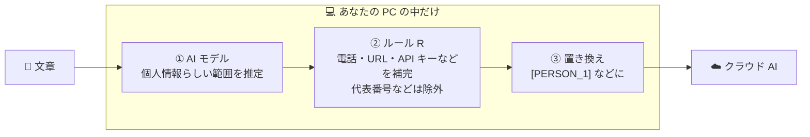
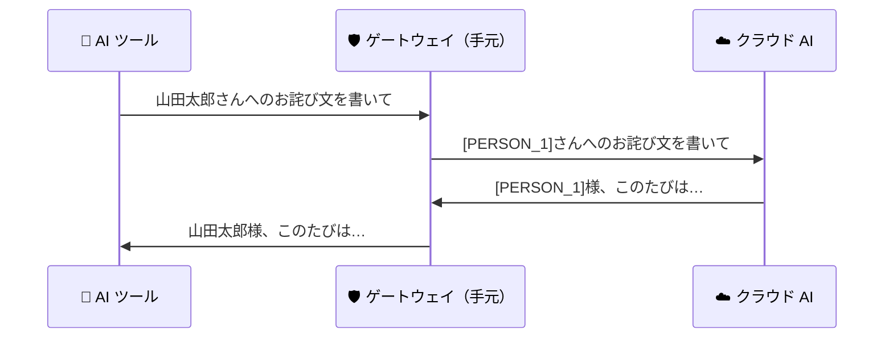
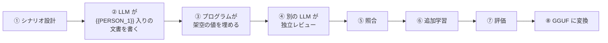

<div align="center">

# 🐯 Toramon Mask

**日本語の文章から個人情報を見つけて伏せる、オープンソースのマスキングツール**

社内の文章を ChatGPT や Claude などのクラウド AI に送る前に、**自分の PC の中だけで** 氏名・住所・電話番号・API キーなどを伏せ字にします。

[](LICENSE)
[](https://www.python.org/)
[](#-動作環境ミニマムスペック)
[](#-動作環境ミニマムスペック)
[](#-セキュリティ)
[](#-toramon-shield-について)

[動作環境](#-動作環境ミニマムスペック) ・ [特長](#-特長) ・ [しくみ](#-しくみ) ・ [クイックスタート](#-クイックスタート) ・ [配布モデル](#-配布モデルmonju-mask-ja-01) ・ [使い方](#-使い方) ・ [精度を測る](#-精度を測る) ・ [学習する](#-自分でモデルを学習する上級者向け) ・ [FAQ](#-よくある質問)

</div>

```text
入力 : 山田太郎様、お届け先は東京都千代田区丸の内1-2-3、連絡先は090-1234-5678 です。
出力 : [PERSON_1]様、お届け先は[ADDRESS_1]、連絡先は[PHONE_1] です。
```

> [!IMPORTANT]
> - このリポジトリには **AI モデルの重みファイルは含まれていません**。公開モデルは [クイックスタート](#-クイックスタート) の手順で自動ダウンロードします。
> - どのモデルも **見逃しはゼロになりません**。重要な文書は人の目でも確認してください。

---

## 💻 動作環境（ミニマムスペック）

**GPU は要りません。** ふつうの Linux PC や、クラウドの小さな仮想マシンで動きます。

| | 🟢 最低限（試す・使う） | 🔵 推奨（快適に使う） | 🟣 学習もする |
|---|---|---|---|
| **OS** | Linux（64bit） | Ubuntu 22.04 / 24.04 | Ubuntu 24.04 |
| **CPU** | 64bit・2 コア | 4 コア以上 | — |
| **メモリ** | **4 GB**（軽量版モデル q8 を使う場合） | 8 GB 以上 | 64 GB 以上 |
| **GPU** | 不要 | 不要（NVIDIA GPU があれば高速化できる） | NVIDIA GPU（CUDA 対応）必須 |
| **ディスク** | 空き **6 GB** | 空き 10 GB | 空き 50 GB 以上 |
| **ソフト** | `git`、`cmake` 3.20 以上、`g++`、Python 3.11 以上 | 左に加えて [uv](https://docs.astral.sh/uv/) | 左に加えて Docker、NVIDIA Container Toolkit |
| **ネット** | 初回のダウンロード時だけ（約 4.5 GB） | 同左 | 同左（さらに約 5.6 GB） |

<details>
<summary>📏 実測値（どのくらいのメモリと時間を使うか）</summary>

DGX Spark の CPU（Arm 20 コア）で、使うコア数を制限して計測しました。時間はモデルの読み込みを含みます。お使いの PC では前後します。

| モデル | ファイル | 使うメモリ | 約 2,000 字の文書 1 件（4 コア） | 同（20 コア） |
|---|---|---|---|---|
| **q8（軽量版・おすすめ）** | 1.6 GB | 約 1.7 GB | 約 4 秒 | 約 1 秒 |
| f16（標準版） | 2.8 GB | 約 2.9 GB | 約 8 秒 | 約 1.5 秒 |

- 同梱の公開ベンチマーク 5 種類で、**q8 と f16 の点数は完全に同じ** でした。迷ったら q8 を使ってください。
- 一度起動すれば、2 件目からはモデルの読み込みが要りません（ローカル API やゲートウェイとして常駐させる使い方）。
- 学習の動作確認は DGX Spark（GB10、128 GB 統合メモリ）で行いました。これより小さい GPU での学習は確認していません。

</details>

<details>
<summary>🪟 Windows や Mac では使えますか？</summary>

- **Windows**：WSL2 の Ubuntu の中で、Linux と同じ手順で動く見込みです（未確認）。
- **macOS**：今は対応していません。ビルドスクリプトが Linux 用の共有ライブラリ（`.so`）を作るためです。
- **Windows / Mac で使うだけなら**：Linux のサーバーでゲートウェイを動かし、各 PC からはブラウザ拡張やクリップボードツールでつなぐ方法があります（[docs/gateway_README.md](docs/gateway_README.md)）。

</details>

---

## ✨ 特長

| | 特長 | 説明 |
|:---:|---|---|
| 🔒 | **外に出さない** | 判定は手元の PC で動く小さな AI モデル（約 15 億パラメータ）とルールで行います。文章をどこにも送りません |
| 🇯🇵 | **日本語に強い** | 日本語の氏名・住所・電話番号・口座番号・マイナンバーなどを対象にした公開モデルを使います |
| 🏢 | **仕事の情報は残す** | 会社の代表番号、共用メール（`info@` など）、納期、金額、型番は伏せません（[保護方針](docs/annotation_policy.md)） |
| 🔁 | **元に戻せる** | ゲートウェイ経由なら、AI の返事に含まれる `[PERSON_1]` を元の名前に戻して表示します |
| 🛑 | **鍵は送らせない** | API キーやパスワードを含む文章は、クラウドへの送信そのものを止められます |
| 🧩 | **4 通りの使い方** | コマンド、ローカル API、ゲートウェイ（OpenAI 互換・Claude Code・Codex）、ブラウザ拡張 |
| 🎓 | **育てられる** | 自分の業務文書に合わせて追加学習し、点数で比べるための一式（合成データ生成、独立レビュー、評価器）つき |
| 📄 | **自由に使える** | Apache-2.0。商用・社内利用、改変、再配布ができます |

---

## 🔍 しくみ



1. **AI モデル** が、文章のどこからどこまでが個人情報かを推定します（「トークン分類」という方式です。文章を作る AI ではありません）。
2. **共通ルール R**（[`configs/rules_R.yaml`](configs/rules_R.yaml)）が、形の決まった情報の見逃しを補い、範囲のずれを直し、残すべきものを除外します。
3. 見つかった範囲を `[PERSON_1]` のような **伏せ字** に置き換えます。

### 伏せる 8 種類

| 種類 | 例 | 伏せ字 |
|---|---|---|
| 👤 個人名 | 山田太郎、ヤマダ タロウ | `[PERSON_n]` |
| 🏠 個人の住所 | 東京都千代田区丸の内1-2-3 | `[ADDRESS_n]` |
| 📞 個人の電話番号 | 090-1234-5678 | `[PHONE_n]` |
| ✉️ 個人のメール | taro.yamada@example.co.jp | `[EMAIL_n]` |
| 📅 個人に紐づく日付 | 生年月日、入院日 | `[DATE_n]` |
| 🔢 番号類 | 口座番号、会員番号、マイナンバー | `[ACCOUNT_n]` |
| 🔗 個人に紐づく URL | パスワード再設定リンク | `[URL_n]` |
| 🔑 認証情報 | パスワード、API キー、トークン | `[SECRET_n]` |

---

## 🚀 クイックスタート

GPU なしで、**約 15 分** で試せます。以下はすべてターミナルで実行します。

### 1. 必要なものを入れる

Ubuntu の場合は、次の 2 行で揃います。

```bash
sudo apt update && sudo apt install -y git cmake build-essential python3 python3-venv curl
curl -LsSf https://astral.sh/uv/install.sh | sh   # uv（Python の高速なパッケージ管理ツール）
```

入れたあと、ターミナルを開き直してください（`uv` コマンドが使えるようになります）。

### 2. ダウンロードして準備する

```bash
git clone https://github.com/toramon-shield/toramon-mask.git
cd toramon-mask

uv venv --python 3.12 .venv                                       # 専用の Python 環境を作る
uv pip install -p .venv/bin/python -r env/requirements-host.txt   # 必要なライブラリ
uv pip install -p .venv/bin/python -e .                           # Toramon Mask 本体
```

<details>
<summary>💡 uv を使わない場合</summary>

```bash
python3 -m venv .venv
.venv/bin/pip install -r env/requirements-host.txt
.venv/bin/pip install -e .
```

</details>

### 3. 推論エンジンをビルドする

```bash
scripts/setup_third_party.sh          # 推論エンジン（privacy-filter-jp.cpp）を決まった版で取得
PF_CUDA=OFF env/build_pfshared.sh     # CPU 版をビルド（数分）
```

`OK: .../libpf.so` と表示されれば成功です。

<details>
<summary>⚡ NVIDIA GPU で高速化したい場合</summary>

CUDA Toolkit（`nvcc`）が入っていれば、`PF_CUDA=OFF` の代わりに GPU の世代を指定して GPU 版をビルドできます。

```bash
CUDA_ARCH=89 env/build_pfshared.sh    # RTX 30 系 = 86、RTX 40 系 = 89、H100 = 90、DGX Spark = 121
```

以降のコマンドの `--device cpu` を `--device cuda` に変えてください。

</details>

### 4. モデルをダウンロードする（約 4.5 GB）

```bash
scripts/download_models.sh
```

軽量版（q8）と標準版（f16）の両方を `models/` に保存し、ファイルが壊れていないか（SHA256）まで自動で確かめます。最後に `OK` が並べば成功です。

### 5. 動かしてみる 🎉

```bash
echo "山田太郎様、お届け先は東京都千代田区丸の内1-2-3、連絡先は090-1234-5678、メールは taro.yamada@example.co.jp です。担当: 株式会社サンプル商事 営業部" \
  | .venv/bin/python scripts/toramon_cli.py redact --backend S --device cpu \
      --gguf models/sumeshi-privacy-filter-jp-GGUF/privacy-filter-jp-q8.gguf
```

次のように表示されれば完成です。会社名は「仕事の情報」なので伏せられていません。

```text
[PERSON_1]様、お届け先は[ADDRESS_1]、連絡先は[PHONE_1]、メールは [EMAIL_1] です。担当: 株式会社サンプル商事 営業部
```

<details>
<summary>🧪 テストを実行する（任意）</summary>

```bash
TORAMON_TEST_DEVICE=cpu .venv/bin/python -m pytest -q     # CPU 版をビルドした場合
.venv/bin/python -m pytest -q                             # GPU 版をビルドした場合
```

`105 passed` のように表示されれば成功です。libpf やモデルがまだない場合、それらを使うテストは自動でスキップされます。

</details>

---

## 🏆 配布モデル（monju-mask-ja-01）

CPU だけで速く動く小型モデル **Monju Mask** を、Hugging Face で配布しています。
「三人寄れば文殊の知恵」のとおり、見方の違う小さなモデル 3 つが同じ文を同時に読み、3 つの判定（確率）を平均して決めます。GPU も、推論エンジンのビルド（クイックスタートのステップ 3）も要りません。

| | monju-mask-ja-01 | openai/privacy-filter | sumeshi/privacy-filter-jp |
|---|---|---|---|
| 約 900 字の文書 1 件（CPU 4 スレッド） | **16.8 ms** | 442.3 ms | 377.1 ms |
| 同（CPU 1 スレッド） | **40.7 ms** | 1,424.5 ms | 1,458.9 ms |
| ファイルの大きさ | **234 MB** | 1.6 GB（8 ビット） | 1.6 GB（8 ビット） |
| 業務文書 1,000 件（Monju PII Bench）の strict F1 | **0.943** | 0.580 | 0.662 |
| 人が書いた短文 106 件（privacy-filter-jp ベンチ v2）の strict F1 | 0.833 | 0.573 | **0.894** |

速度は Arm CPU（Cortex-X925）での実測、精度はルール R 併用の値です。どのモデルも、自分の作者が作ったベンチで最も良い成績になります。
Monju でも、業務文書の 17% に何らかの個人情報が残り、個人情報のない文書の 22% で誤って何かを伏せます。**匿名化を保証するものではありません。**

👉 **[huggingface.co/toramon/monju-mask-ja-01](https://huggingface.co/toramon/monju-mask-ja-01)**（評価の詳細、既知の弱点、学習データの出典はモデルカードにあります）
評価に使った業務文書 1,000 件は **[Monju PII Bench](https://huggingface.co/datasets/toramon/monju-pii-bench)** として公開しています。

### 使ってみる

クイックスタートのステップ 1〜2 が終わっていれば使えます。

```bash
# 1) 追加のライブラリを入れる（ONNX Runtime）
uv pip install --python .venv/bin/python onnxruntime

# 2) ダウンロード（約 230 MB）
.venv/bin/hf download toramon/monju-mask-ja-01 --local-dir models/monju-mask-ja-01

# 3) 動かす
echo "山田太郎様、お届け先は東京都千代田区丸の内1-2-3、連絡先は090-1234-5678 です。" \
  | .venv/bin/python scripts/toramon_cli.py redact --backend monju --model-dir models/monju-mask-ja-01
# → [PERSON_1]様、お届け先は[ADDRESS_1]、連絡先は[PHONE_1] です。
```

以降の [使い方](#-使い方) では、最初に設定する変数を次のように変えるだけで、すべての方法（コマンド、ローカル API、ゲートウェイ）がこのモデルで動きます。

```bash
BACKEND=monju
GGUF=models/monju-mask-ja-01      # Monju はフォルダを指定します
```

使う CPU スレッド数は `--threads`（既定 4）で変えられます。

### 🔁 モデルを切り替える

Toramon Mask は、検出に使うモデルを `--backend` で切り替えられます。ルール、伏せ字化、ローカル API、ゲートウェイはどのモデルでも同じです。

| `--backend` | モデル | 指定するもの | 必要なもの |
|---|---|---|---|
| `monju` | [toramon/monju-mask-ja-01](https://huggingface.co/toramon/monju-mask-ja-01)（小型、CPU 向け） | `--model-dir` にフォルダ | onnxruntime |
| `S` | [sumeshi/privacy-filter-jp-GGUF](https://huggingface.co/sumeshi/privacy-filter-jp-GGUF) | `--gguf` にファイル | libpf（ステップ 3） |
| `T-O` / `T-S` | このリポジトリの手順で自分で追加学習したモデル | `--gguf` か `--checkpoint` | libpf か PyTorch |
| `O` | [openai/privacy-filter](https://huggingface.co/openai/privacy-filter)（英語中心） | `--checkpoint` | PyTorch と公式ランタイム |

Python から使う場合も同じで、`.detect(text)` を持つ検出器を `ToramonFilter` に渡すだけです。

```python
from toramon.adapters.monju_onnx import load_monju
from toramon.filter import ToramonFilter

filt = ToramonFilter(load_monju("models/monju-mask-ja-01", threads=4), "monju-mask-ja-01")
print(filt.redact("山田太郎様の電話は090-1234-5678です。").redacted_text)
```

---

## 📖 使い方

長いパスは変数にしておくと楽です。

```bash
BACKEND=S      # 配布モデル monju-mask-ja-01 を使う場合は monju（GGUF にはフォルダを指定）
GGUF=models/sumeshi-privacy-filter-jp-GGUF/privacy-filter-jp-q8.gguf
DEV=cpu        # GPU 版をビルドした場合は cuda
```

| やりたいこと | 方法 |
|---|---|
| ファイルを伏せ字にしたい | [⌨️ コマンド](#コマンドcli) |
| 自分のプログラムから呼びたい | [🔌 ローカル API](#ローカル-api) または [🐍 Python](#python-から使う) |
| ChatGPT などの API に送る前に自動で伏せたい | [🛡️ ゲートウェイ](#ゲートウェイopenai-互換プロキシ) |
| ブラウザやクリップボードで使いたい | [docs/gateway_README.md](docs/gateway_README.md) |

### コマンド（CLI）

```bash
# 伏せ字にした文章を出力
cat 文書.txt | .venv/bin/python scripts/toramon_cli.py redact --backend $BACKEND --device $DEV --gguf $GGUF

# どこを何として検出したかを JSON で出力（開始・終了位置、種類、確信度）
cat 文書.txt | .venv/bin/python scripts/toramon_cli.py detect --backend $BACKEND --device $DEV --gguf $GGUF
```

| オプション | 意味 |
|---|---|
| `--style asterisk` | `[PERSON_1]` ではなく `****` で伏せる |
| `--no-rules` | ルール R を使わず、モデルだけで判定する（比較用） |
| `--threshold 0.5` | 確信度のしきい値。上げると伏せる量が減り、下げると増える |
| `--backend monju` | 配布モデル（[monju-mask-ja-01](#-配布モデルmonju-mask-ja-01)）を使う。`--model-dir` にフォルダを指定 |
| `--backend T-O` / `T-S` | 自分で学習・変換したモデルを使う |

### ローカル API

```bash
.venv/bin/python scripts/toramon_cli.py serve --backend $BACKEND --device $DEV --gguf $GGUF --port 8765
```

別のターミナルから:

```bash
curl -s -X POST http://127.0.0.1:8765/redact -H 'Content-Type: application/json' \
  -d '{"text":"佐藤花子さんの電話は080-1111-2222です。"}'
# → {"status":"ok", "redacted_text":"[PERSON_1]さんの電話は[PHONE_1]です。", "spans":[...], ...}
```

| エンドポイント | 内容 |
|---|---|
| `GET /health` | 動作確認 |
| `POST /detect` | 検出結果（範囲の一覧）を返す |
| `POST /redact` | 伏せ字にした文章と検出結果を返す（`"restorable": true` で復元用の鍵も返す。下の「伏せた値を元に戻す」） |
| `POST /restore` | 鍵を使って元に戻す（`serve --allow-restore` のときだけ） |

既定では、自分の PC（`127.0.0.1`）からしか接続できません。

### ゲートウェイ（OpenAI 互換プロキシ）

AI ツールとクラウドの間に挟むと、**送る文章は自動で伏せ字に、返ってきた答えは元の値に戻して** くれます。



```bash
.venv/bin/python scripts/toramon_gateway.py --backend $BACKEND --device $DEV --gguf $GGUF \
  --port 8787 --upstream https://api.openai.com

# AI ツール側は、接続先をゲートウェイに向けるだけ（API キーは今までどおり。ゲートウェイは保存しません）
export OPENAI_BASE_URL=http://127.0.0.1:8787/v1
```

- `http://127.0.0.1:8787/admin` で、伏せた件数などの集計を見られます（原文は記録しません）。
- `--block-labels secret`（既定）: API キーやパスワードを含む要求は、送信そのものを止めます。

<details>
<summary>🧪 本物の API に送らずに試す</summary>

受け取った文章をそのまま返すダミーの送信先を使えます。

```bash
.venv/bin/python scripts/mock_upstream.py --port 8799        # ターミナル 1
.venv/bin/python scripts/toramon_gateway.py --backend $BACKEND --device $DEV --gguf $GGUF \
  --port 8787 --upstream http://127.0.0.1:8799                # ターミナル 2
```

</details>

ブラウザ拡張、クリップボード常駐ツール、社内配布の方法は [docs/gateway_README.md](docs/gateway_README.md) を見てください。

### Claude Code・Codex の送受信を伏せる

コーディングエージェントも、接続先をゲートウェイに向けるだけで使えます。エージェントが送る会話（指示、ファイルの中身、コマンドの結果）は伏せ字にして送られます。
返ってきた答えとツールの呼び出し（ファイルへの書き込みやコマンド）は、手元で元の値に戻ってから実行されます。ストリーミングの途中で `[PERSON_1]` が 2 つに分かれて届いても、つなぎ直して戻します。

ここでは配布モデル Monju Mask（[🏆 配布モデル](#-配布モデルmonju-mask-ja-01)）を使います。CPU だけで、1 回の要求あたり数十〜数百ミリ秒です。

**Claude Code**（Anthropic のログインでも API キーでも同じ）

```bash
# ターミナル 1: ゲートウェイ
.venv/bin/python scripts/toramon_gateway.py --backend monju --model-dir models/monju-mask-ja-01 \
  --port 8787 --upstream https://api.anthropic.com --block-labels ""

# ターミナル 2: Claude Code
ANTHROPIC_BASE_URL=http://127.0.0.1:8787 claude
```

いつも通すなら、`~/.claude/settings.json` に書いておきます。

```json
{ "env": { "ANTHROPIC_BASE_URL": "http://127.0.0.1:8787" } }
```

**Codex**（ChatGPT でログインしている場合）

```bash
# ターミナル 1: ゲートウェイ（送信先は chatgpt.com）
.venv/bin/python scripts/toramon_gateway.py --backend monju --model-dir models/monju-mask-ja-01 \
  --port 8788 --upstream https://chatgpt.com --block-labels ""
```

`~/.codex/config.toml` に追記します。

```toml
model_provider = "toramon"

[model_providers.toramon]
name = "Toramon Gateway"
base_url = "http://127.0.0.1:8788/backend-api/codex"
wire_api = "responses"
requires_openai_auth = true    # ChatGPT のログインをそのまま使う
```

OpenAI の API キーで使っている場合は、ゲートウェイを `--upstream https://api.openai.com` で起動し、`base_url = "http://127.0.0.1:8788/v1"` と `env_key = "OPENAI_API_KEY"` にします（`requires_openai_auth` は不要）。

**確かめ方**

```bash
# 上流へ実際に送った本文（伏せた後）をフォルダに残す
.venv/bin/python scripts/toramon_gateway.py ... --dump-dir /tmp/toramon-dump
grep -l "佐々木花子" /tmp/toramon-dump/*.json || echo "送信本文に名前は含まれていません"
```

2026-11-18 に、Claude Code 2.1.327 と Codex（ChatGPT ログイン）で次のことを確かめました。指示に入れた架空の氏名・電話番号は、上流へ送った本文には現れず、`[PERSON_1]`・`[PHONE_1]` になっていました。
答えの表示と、エージェントが書いたファイルの中身は、元の氏名・電話番号に戻っていました。

| | Claude Code | Codex |
|---|---|---|
| 1 回の要求で調べた文字数 | 約 1.9 万〜2.8 万字 | 約 8.4 万字 |
| 伏せる処理の時間（初回 / 2 回目以降） | 114〜214 ms / 3〜4 ms | 1,003 ms / 15 ms |

エージェントは毎回、会話の履歴全体を送り直します。ゲートウェイは一度調べた文章の結果を覚えておくので、2 回目以降は新しく増えた部分だけを調べます。

知っておいてほしいこと:

- **伏せる範囲**: 会話（指示、ファイル、コマンド結果、ツールの入出力）を伏せます。エージェントのシステムプロンプトとツールの定義は伏せません（`--mask-system` で伏せます）。思考（thinking / reasoning）は改ざん検知の署名がついているので、そのまま通します。
- **誤検知**: Codex が自動で付ける環境情報の中のハッシュ値や ID も、電話番号や秘密情報として伏せられることがあります。答えとツール呼び出しでは元に戻るので、作業は止まりません。
- **`--block-labels ""` を付ける理由**: 既定の `secret` のままだと、秘密情報らしい文字列（上のハッシュ値など）が 1 つでも含まれた要求を送らずに止めます。エージェントでは会話全体が毎回送られるので、一度止まると先へ進めなくなります。止めたい場合は既定のまま使い、`/admin` で件数を確かめてください。
- **送らないものは守れない**: ゲートウェイを通らない通信（Web 検索など、ほかのサービスへの接続）は伏せません。
- **画像・PDF の添付**: 既定ではそのまま送ります。伏せるには、次の「画像・PDF も伏せる」の設定が必要です。

### 画像・PDF も伏せる（任意、共用サーバー）

画像の文字を読む（OCR）処理は重いので、社内の共用サーバー 1 台に任せます。**個人情報かどうかの判定、塗りつぶし、元に戻す対応表は、これまでどおり各自の PC のゲートウェイで行います。** 共用サーバーは画像を受け取り、読んだ文字と位置を返すだけで、何も保存しません。

```
各自の PC（ゲートウェイ）                       共用サーバー（toramon_vision_server.py）
  添付の画像・PDF を見つける
  PDF は 1 ページずつ画像にする
  画像 ──────── HTTPS + 利用者トークン ───────→  OCR（文字と 1 文字ごとの位置）
       ←───────────────────────────────────   （保存しない・ログは件数と時間だけ）
  Monju で判定し、該当の位置を黒く塗って [PERSON_1] などを書き込む
  （文章と同じ番号。AI が答えで [PERSON_1] と書けば元に戻る）
  伏せた画像・PDF だけをクラウド AI へ
```

**共用サーバーの準備**（管理者が 1 回だけ）

```bash
# OCR に使うライブラリ（初回の起動時に PP-OCRv5 のモデル約 170 MB を自動で取得します）
uv pip install --python .venv/bin/python pillow rapidocr onnxruntime

# 利用者ごとにトークンを発行する（表示は 1 回だけ。ファイルにはハッシュ値だけが残ります）
.venv/bin/python scripts/toramon_vision_server.py --tokens /etc/toramon/vision_tokens.txt --add-user sato

# 起動する（社内ネットワークに出すときは TLS が必須。証明書がないと起動しません）
.venv/bin/python scripts/toramon_vision_server.py --tokens /etc/toramon/vision_tokens.txt \
  --host 0.0.0.0 --port 8790 --tls-cert server.crt --tls-key server.key --workers 4 --threads 4
```

**各自の PC の設定**

```bash
uv pip install --python .venv/bin/python pillow pypdfium2 cryptography
echo "<発行されたトークン>" > ~/.toramon/vision_token && chmod 600 ~/.toramon/vision_token

.venv/bin/python scripts/toramon_gateway.py --backend monju --model-dir models/monju-mask-ja-01 \
  --upstream https://api.anthropic.com --port 8787 --block-labels "" \
  --vision-url https://vision.社内.example:8790 --vision-token-file ~/.toramon/vision_token
```

`--vision-url` を付けると、添付は既定で「伏せて送る」になります。

| 添付の種類 | 扱い |
|---|---|
| 画像（PNG・JPEG・WebP など） | OCR で読み、個人情報の位置を塗ります。撮影場所（GPS）などの付帯情報は消えます |
| 文字情報のある PDF | 文字と位置は PDF から直接読みます（共用サーバーは使いません）。ページの中に画像があれば、そこは OCR で読みます |
| スキャンした PDF | 全ページを OCR で読みます |
| 出力の PDF | 塗った後のページ画像だけで作り直します。元の文字情報・注釈・作成者・埋め込みファイルは残りません |
| URL やファイル ID だけの添付 | 中身を確かめられないので、要求を止めます |
| 確かめられなかったとき（サーバー停止、壊れたファイル、30 ページ超など） | 要求を止めます（`--vision-on-fail drop` にすると、添付を外して送ります） |

オプション: `--attachments drop`（添付は常に外す）、`--attachments block`（添付があれば止める）、`--pdf-max-pages`（既定 30）。

**高精度オプション（VLM）**: 共用サーバーに、画像を読める AI（OpenAI 互換の API で動く公開モデル。vLLM など）を同じサーバー内で動かし、`--vlm-url http://127.0.0.1:8000/v1 --vlm-model <モデル名>` で指定します。ゲートウェイに `--vision-vlm` を付けると、OCR に加えてその AI にも「写っている個人情報」を答えさせ、OCR が読み落とした手書きの文字や写真の中の文字も塗ります。画像を外へ出さないよう、VLM は共用サーバーの中（ループバック）にしか置けません。

**速さ**: OCR は CPU で 1 ページあたり数秒かかります（下の測定を参照）。エージェントは毎回、会話全体（添付を含む）を送り直すので、ゲートウェイは OCR の結果を 30 分だけ覚えておきます（`--vision-cache-ttl`）。覚えておく中身は **元の画像を持っている人にしか読めない形** で暗号化しています（鍵は画像そのもののハッシュから作るため、メモリを覗いても元の画像がなければ読めません）。

**精度**（文書を A4・150 dpi の画像に描いて測定。まず VLM なし。`scripts/eval_vision.py`、結果は `results/vision/`）

「すべて塗られた」は、個人情報 1 件の文字が 1 文字も残らず塗られた割合です（1 文字でも見えていれば漏れと数えます）。

| データ | 条件 | すべて塗られた | 個人情報の文字のうち塗られた割合 | 個人情報でない文字を塗った割合 | 1 枚の処理時間（中央値） |
|---|---|---|---|---|---|
| Monju PII Bench（100 文書・873 件） | 文章を直接判定（画像なし、上限の目安） | 98.3% | 99.0% | 1.1% | — |
| | きれいな画像 | 93.8% | 94.9% | 2.6% | 8.3 秒 |
| | スキャン風（傾き・ぼかし・JPEG・ノイズ） | 86.9% | 96.2% | 2.4% | 6.7 秒 |
| 学習・調整に使っていない社内データ devx（100 文書・601 件） | 文章を直接判定 | 97.5% | 98.9% | 0.2% | — |
| | きれいな画像 | 92.2% | 95.9% | 0.7% | 7.6 秒 |
| | スキャン風 | 81.7% | 93.4% | 0.7% | 8.2 秒 |

処理時間は共用サーバーの CPU（4 本並列）で測ったものです。

- 取りこぼしの主な原因は OCR の読み違いです。たとえば「〒」を「亍」と、「フリガナ」を「リガナ」と読んでいました。スキャン風の画像ほど増えます。
- 一部の手直しは、Monju PII Bench での取りこぼしを見てから入れました（OCR が落とした語の間の空白を戻す、行の折り返しをつなぐ、よく取り違える文字を直す）。手直しの前の「すべて塗られた」は、きれいな画像で 91.2%、スキャン風で 85.1% でした。devx は手直しの後に初めて測った数字です。
**VLM を足したときの精度**（Qwen3-VL-8B-Instruct を vLLM で動かして測定。同じ 100 文書。結果は `results/vision/eval_*_vlm.json`）

| データ | 条件 | 塗り方 | すべて塗られた | 個人情報の文字のうち塗られた割合 | 個人情報でない文字を塗った割合 |
|---|---|---|---|---|---|
| Monju PII Bench | きれいな画像 | OCR だけ | 93.8% | 94.9% | 2.6% |
| | | ＋VLM | 96.9% | 98.5% | 8.5% |
| | スキャン風 | OCR だけ | 86.9% | 96.2% | 2.4% |
| | | ＋VLM | 94.6% | 98.4% | 7.9% |
| devx | きれいな画像 | OCR だけ | 92.2% | 95.9% | 0.7% |
| | | ＋VLM | 96.8% | 98.3% | 4.0% |
| | スキャン風 | OCR だけ | 81.7% | 93.4% | 0.7% |
| | | ＋VLM | 93.7% | 98.0% | 4.5% |

「＋VLM」は、VLM が答えた文字列を OCR の文字列からあいまい一致で探して塗り、見つからなければ VLM が返した位置を塗る方式です（ゲートウェイの既定）。

- 取りこぼしは大きく減りますが、個人情報でない文字を塗る量は 3〜6 倍に増えます（VLM が会社名や品名を個人情報と答えることがあるため）。
- 1 枚の処理時間は、GPU 1 枚の上で 4 枚同時に処理して中央値 33〜37 秒、遅いもので 60〜90 秒でした（順番待ちを含む）。OCR だけのときの数倍です。
- 400 枚のうち VLM が失敗したのは 1 枚で、そのときは OCR だけで塗りました（`--vision-vlm-required` を付けると、失敗時は添付を止めます）。何も答えなかった画像は約 1 割ありました。
- VLM への指示文は、devx での 1 回目の測定の答えを見てから直しました（答えるべき種類の名前を指示文からそのまま写してしまい、正しい答えを捨てていたため）。上の表は直した後の数字です。

- **画像では文章ほど確実には伏せられません。** 機密性の高い書類は、画像ではなく文章で渡すか、`--attachments block` で添付を止めることを勧めます。

### 伏せた値を元に戻す（API・CLI、任意）

ゲートウェイ経由の AI の答えは、自動で元の値に戻ります。自分で `/redact` や CLI を使って伏せ、別の場所で処理した結果を元に戻したいときは、次の仕組みを使います。**既定では無効**で、起動時に有効にしたときだけ使えます。

Toramon Mask は個人情報を持ち続けない作りです。そのため元に戻すための対応表（`[PERSON_1]` ↔ 元の値）も、次の決まりで扱います。

| 決まり | 内容 |
|---|---|
| 置き場所 | ゲートウェイか API のメモリの中だけ。ディスク・監査ログには書きません |
| 渡すもの | 対応表そのものは返さず、推測できない使い捨ての鍵（`restore_token`、256 ビットの乱数）だけを返します |
| 消えるとき | **1 回元に戻したとき**か、**期限（既定 60 秒、上限 60 秒）が来たとき**の早い方 |
| 期限切れ・使用済みのとき | 元に戻さず、**伏せたままの文章**を返します（HTTP 410、CLI は終了コード 3）。期限切れ・使用済み・存在しない鍵は区別しません |
| 待ち受け先 | `127.0.0.1` などのループバックだけ。ほかのアドレスで有効にしようとすると起動しません |
| その他 | 応答に `Cache-Control: no-store` を付けます。件数の上限（1,024 件）を超えたら古いものから消します（消えた分は伏せたままになります） |

**CLI だけで完結させる（`run`）**。伏せた文章をコマンドの標準入力へ渡し、コマンドの出力を元に戻して表示します。対応表は CLI のメモリの中だけにあり、コマンドが終わって元に戻した時点か、`--ttl` 秒（既定 60）が来た時点で消えます。コマンドが期限内に終わらなかったときは、伏せたまま表示します。

```bash
cat 依頼文.txt | .venv/bin/python scripts/toramon_cli.py run --backend monju --model-dir models/monju-mask-ja-01 \
  -- <伏せた文章を標準入力で受け取って AI に送るコマンド>
# 例: 「佐々木花子さん（090-1234-5678）に見積書を…」
#   コマンドが受け取る: [PERSON_1]さん（[PHONE_1]）に見積書を…
#   画面に出る:         佐々木花子さん（090-1234-5678）に見積書を…
```

**API に預けて、あとで戻す**。ゲートウェイは `--allow-restore-api`、ローカル API は `serve --allow-restore` で有効になります（`--restore-ttl` / `--ttl` で 60 秒より短くできます）。

```bash
# 伏せる（restorable: true を付けると restore_token が返る）
curl -s -X POST http://127.0.0.1:8765/redact -H 'Content-Type: application/json' \
  -d '{"text":"佐藤花子さんの電話は080-1111-2222です。","restorable":true}'
# → {"redacted_text":"[PERSON_1]さんの電話は[PHONE_1]です。", "restore_token":"…", "expires_in":60, ...}

# 60 秒以内に、AI の答えなどを元に戻す（鍵はこの 1 回で消える）
curl -s -X POST http://127.0.0.1:8765/restore -H 'Content-Type: application/json' \
  -d '{"restore_token":"…","text":"[PERSON_1]様へ折り返しは[PHONE_1]まで"}'
# → {"text":"佐藤花子様へ折り返しは080-1111-2222まで", "restored":true, "replaced":2}
# 期限切れ・使用済み → HTTP 410 {"text":"[PERSON_1]様へ…", "restored":false, "reason":"expired_or_used"}

# 使わなくなったら、期限を待たずに消せる
curl -s -X POST http://127.0.0.1:8765/restore -H 'Content-Type: application/json' -d '{"restore_token":"…","discard":true}'
```

CLI からも同じことができます（`--server` に起動中の API かゲートウェイを指定）。

```bash
echo "佐藤花子さんの電話は080-1111-2222です。" | .venv/bin/python scripts/toramon_cli.py redact --server http://127.0.0.1:8765 --restorable
#   標準出力: 伏せた文章 / 標準エラー: restore_token=… expires_in=60
echo "[PERSON_1]様へ" | .venv/bin/python scripts/toramon_cli.py restore --server http://127.0.0.1:8765 --token <restore_token>
```

注意: `restore_token` を持っている人は、期限内なら 1 回だけ元の値を取り出せます。ログやチャットに貼らないでください。AI がプレースホルダの形を変えた場合（括弧を落とす、言い換えるなど）は、その部分は元に戻りません。

### Python から使う

```python
from toramon.adapters.sumeshi_pf import SumeshiPF
from toramon.filter import ToramonFilter

det = SumeshiPF("models/sumeshi-privacy-filter-jp-GGUF/privacy-filter-jp-q8.gguf", device="cpu")
f = ToramonFilter(det, "S")
res = f.redact("山田太郎様の電話は090-1234-5678です。")
print(res.redacted_text)        # [PERSON_1]様の電話は[PHONE_1]です。
for s in res.spans:
    print(s["start"], s["end"], s["label"])
```

---

## 📊 精度を測る

正解つきのデータ（JSONL 形式）でモデルを動かし、点数を出せます。sumeshi さんの公開ベンチマークを変換したものを [`data/public_bench/`](data/public_bench/) に同梱しています。

```bash
# 1) モデルで予測する
.venv/bin/python scripts/run_model.py --model S --device $DEV --gguf $GGUF \
  --input data/public_bench/sumeshi_eval2.jsonl --out runs/demo/S_eval2.pred.jsonl

# 2) 正解と比べて採点する
.venv/bin/python scripts/evaluate.py --gold data/public_bench/sumeshi_eval2.jsonl --pred runs/demo/S_eval2.pred.jsonl
```

<details>
<summary>🔬 ルール R の効果を比べる（差の 95% 信頼区間つき）</summary>

```bash
.venv/bin/python scripts/run_filter.py --backend S --device $DEV --gguf $GGUF \
  --input data/public_bench/sumeshi_eval2.jsonl --out runs/demo/S_model_only.pred.jsonl --config model_only
.venv/bin/python scripts/run_filter.py --backend S --device $DEV --gguf $GGUF \
  --input data/public_bench/sumeshi_eval2.jsonl --out runs/demo/S_rules_all.pred.jsonl --config rules_all
.venv/bin/python scripts/evaluate.py --gold data/public_bench/sumeshi_eval2.jsonl \
  --pred runs/demo/S_rules_all.pred.jsonl --compare runs/demo/S_model_only.pred.jsonl
```

</details>

| 指標 | 意味 | 良い方向 |
|---|---|---|
| strict F1 | 範囲と種類が **完全に一致** した割合（適合率と再現率の調和平均） | ⬆️ 高い |
| 全範囲保護率 | 正解の個人情報が **1 文字も漏れずに** 伏せられた割合 | ⬆️ 高い |
| PII 残存文書率 | 個人情報が 1 つでも残った文書の割合 | ⬇️ 低い |
| 非対象文字マスク率 | 伏せなくてよい文字まで伏せた割合（伏せすぎ） | ⬇️ 低い |
| 負例文書誤検知率 | 個人情報のない文書で、誤って何かを伏せた割合 | ⬇️ 低い |

> [!NOTE]
> 公開ベンチは作者の方針で正解が付けられているため、このリポジトリの [保護方針](docs/annotation_policy.md) とは一部で判断が異なります。動作確認・診断用と考えてください。

データ形式（1 行 1 文書）は [`configs/data_schema.json`](configs/data_schema.json) で定義しています。`start` / `end` は **文字単位** の位置です。

```json
{"id": "doc-1", "text": "山田太郎様", "entities": [{"start": 0, "end": 4, "label": "private_person", "action": "MASK"}]}
```

---

## 🎓 自分でモデルを学習する（上級者向け）

自分の業務文書に合わせてモデルを鍛えられます。**NVIDIA GPU と Docker が必要** です（[動作環境](#-動作環境ミニマムスペック) の「学習もする」列）。



> [!TIP]
> LLM には `{{PERSON_1}}` のような **プレースホルダ入りの文書** だけを書かせ、氏名や電話番号は **プログラムが架空の値を埋め込みます**（[`src/toramon/datagen/pools.py`](src/toramon/datagen/pools.py)）。正解の位置が正確になり、実在の個人情報も入り込みません。

<details>
<summary><b>ステップ 1：準備</b></summary>

```bash
scripts/download_models.sh --all          # OpenAI のモデルも取得（さらに約 5.6 GB）
docker build -f env/Dockerfile -t toramon-mask:0.1 .   # 学習用コンテナ（先に setup_third_party.sh が必要）
./env/run.sh python -c "import torch; print(torch.cuda.is_available())"   # True なら OK

# T-S の起点: sumeshi の GGUF を学習できる HF 形式に戻す
.venv/bin/python scripts/convert_gguf_to_hf.py --gguf models/sumeshi-privacy-filter-jp-GGUF/privacy-filter-jp-f16.gguf \
  --ref models/openai-privacy-filter --out models/sumeshi-privacy-filter-jp-hf-from-f16
```

Dockerfile のベースイメージは DGX Spark（Arm64）向けの NVIDIA PyTorch コンテナです。x86_64 の PC では、同じ世代の `nvcr.io/nvidia/pytorch` に差し替えてください。

</details>

<details>
<summary><b>ステップ 2：学習データを作る</b></summary>

文書の生成とレビューには、次のどれかの LLM を使います。

| 経路 | 使うもの | 必要な設定 |
|---|---|---|
| `gpt` | [OpenAI Codex CLI](https://github.com/openai/codex)（`codex`） | `codex login` 済み |
| `gemini` / `claude` | Antigravity CLI（`agy`） | ログイン済み |
| `local` | OpenAI 互換の API サーバー（vLLM、llama.cpp server、Ollama など） | `TORAMON_LLM_URL`、`TORAMON_LLM_MODEL`（必要なら `TORAMON_LLM_API_KEY`） |

```bash
export TORAMON_LLM_URL=http://127.0.0.1:8000/v1/chat/completions
export TORAMON_LLM_MODEL=qwen3-32b    # サーバーで動かしているモデル名に置き換え

ROUTES=local          # 生成担当。codex や agy も使えるなら gpt,gemini,claude,local など
REVIEWERS=local       # レビュー担当。生成担当とは別の経路が望ましい

for SPLIT in train dev; do
  N=$([ $SPLIT = train ] && echo 3000 || echo 500)
  SEED=$([ $SPLIT = train ] && echo 1 || echo 2)
  .venv/bin/python scripts/make_jobs.py --split $SPLIT --n $N --out data/$SPLIT/jobs.jsonl --seed $SEED --routes $ROUTES  # ① 何を書かせるか
  .venv/bin/python -m toramon.llm.generate --jobs data/$SPLIT/jobs.jsonl --out data/$SPLIT/raw --routes $ROUTES           # ② 生成
  .venv/bin/python scripts/fill_docs.py --raw data/$SPLIT/raw --split $SPLIT --pool $SPLIT --out data/$SPLIT/filled.jsonl # ③ 値を埋める
  .venv/bin/python -m toramon.llm.review --docs data/$SPLIT/filled.jsonl --out data/$SPLIT/reviews --reviewers $REVIEWERS # ④ レビュー
  .venv/bin/python -m toramon.datagen.reconcile --docs data/$SPLIT/filled.jsonl --reviews data/$SPLIT/reviews \
    --out-docs data/$SPLIT/$SPLIT.jsonl --out-report data/$SPLIT/reconcile_report.json                                    # ⑤ 照合
done

.venv/bin/python scripts/audit_splits.py data/train/train.jsonl data/dev/dev.jsonl --out runs/audit/splits.json  # 分割間の重複を検査
```

結果は `data/train/train.jsonl`（学習用）と `data/dev/dev.jsonl`（選抜用）です。

- **独立レビュー**: 書いた本人（同じ LLM）がレビューすると見落としが重なりやすいので、レビュー担当は別の経路が理想です（例: `ROUTES=local REVIEWERS=gpt`）。同じ経路でも動きますが、警告が出ます。`--reviewers` を省くと「生成担当以外の全経路」が使われます。
- 学習用・選抜用・最終評価用は [`configs/scenario_families.yaml`](configs/scenario_families.yaml) で **シナリオ単位** に分けています。似た文書が別の分割に混ざって点数が水増しされるのを防ぐためです。
- 公開データからも作れます: Dolly 日本語版（`scripts/make_dolly_jobs.py` → `src/toramon/llm/generate_batch.py` → `scripts/make_dolly_dataset.py`）、NVIDIA Nemotron-PII-Japan（`scripts/convert_nemotron.py`）。**再配布するときは元のライセンス（CC BY-SA 3.0 / CC BY 4.0）に従ってください。**

</details>

<details>
<summary><b>ステップ 3：学習する</b></summary>

```bash
# T-O: OpenAI モデルを起点に（MoE の experts を凍結して軽く学習）
./env/run.sh python -m toramon.train.finetune_hf --base /models/openai-privacy-filter \
  --train data/train/train.jsonl --dev data/dev/dev.jsonl --out runs/my_to --mode experts_frozen --epochs 3 --lr 1e-4

# T-S: sumeshi モデルを起点に（LoRA で学習）
./env/run.sh python -m toramon.train.finetune_hf --base /models/sumeshi-privacy-filter-jp-hf-from-f16 \
  --train data/train/train.jsonl --dev data/dev/dev.jsonl --out runs/my_ts --mode lora --epochs 3 --lr 1e-4
```

コンテナの中では、リポジトリが `/work`、`models/` が `/models` に見えます。結果は `runs/<名前>/model/`（HF 形式）、`train_summary.json`、`dev_eval.json` に保存されます。

</details>

<details>
<summary><b>ステップ 4：比べる・最終評価・GGUF に変換</b></summary>

```bash
# 複数モデル × ルールあり/なしを一括比較し、report.md / report.csv を作る
.venv/bin/python scripts/run_comparison.py --gold data/dev/dev.jsonl --out runs/dev_compare --title "dev 比較" --baseline S \
  --model S=gguf:$GGUF --model T-O=hf:identity:/work/runs/my_to/model --configs model_only,rules_all

# 最終評価（任意。選んだモデルを test 分割で「一度だけ」評価する）
#  1) ステップ 2 のループを SPLIT=test（例: N=1000, SEED=3）で実行し、結果を置く
mkdir -p eval/locked && cp data/test/test.jsonl eval/locked/filled.jsonl
#  2) 正解を凍結する（人手確認の修正ファイルがあれば --decisions で指定）
.venv/bin/python scripts/freeze_locked_test.py --allow-unverified
#  3) 評価条件を凍結する（候補・基準モデルと評価コードのハッシュを記録）
.venv/bin/python scripts/freeze_conditions.py --candidate T-O=runs/my_to/model --baseline S=$GGUF --reason "dev 比較で選定"
#  4) 一括評価 → runs/final/report.md（CPU 版 libpf の場合は TORAMON_DEVICE=cpu を付ける）
bash scripts/final_eval.sh

# HF 形式 → GGUF に変換（CLI・ゲートウェイで使える形）
bash scripts/convert_hf_to_gguf.sh runs/my_to/model my-to f16
.venv/bin/python scripts/verify_gguf_hf_parity.py --help   # 変換前後で数値が一致するかの検証
```

変換した GGUF は `--backend T-O --gguf runs/gguf/my-to/my-to-f16.gguf` で使えます。評価設計の考え方は [docs/data_design.md](docs/data_design.md) と [configs/acceptance.yaml](configs/acceptance.yaml) にあります。

</details>

---

## 📚 ドキュメント

| ドキュメント | 内容 |
|---|---|
| 🛡️ [docs/gateway_README.md](docs/gateway_README.md) | ゲートウェイ、ブラウザ拡張、クリップボードツール、社内配布 |
| 📏 [docs/annotation_policy.md](docs/annotation_policy.md) | 何を伏せて何を残すかの保護方針 |
| 🧪 [docs/data_design.md](docs/data_design.md) | 学習・評価データの設計（分割、最終テストの隔離） |
| ⚙️ [configs/rules_R.yaml](configs/rules_R.yaml) | 共通ルール R |
| 📐 [configs/data_schema.json](configs/data_schema.json) | データ形式 |

---

## 🗂️ フォルダ構成

```text
toramon-mask/
├── src/toramon/        本体のライブラリ
│   ├── filter.py         検出 → ルール → 置き換えをまとめたフィルタ
│   ├── api.py            ローカル API（FastAPI）
│   ├── evaluate.py       評価器（各指標、ブートストラップ信頼区間）
│   ├── adapters/         モデルごとの呼び出し口（GGUF / OpenAI 公式 / HF 形式）
│   ├── rules/            共通ルール R のエンジン
│   ├── datagen/          合成値の生成・埋め込み・レビュー照合
│   ├── llm/              データ生成・レビュー用 LLM の呼び出し
│   └── train/            追加学習
├── scripts/            CLI、ゲートウェイ、評価、データ作成、変換などのスクリプト
├── configs/            ラベル対応表、ルール R、データ形式、シナリオ分割、受入基準、モデルの SHA256
├── prompts/            データ生成・レビュー用のプロンプト
├── gateway/            ブラウザ拡張、クリップボード常駐ツール、配布用メモ
├── env/                Dockerfile、ビルドスクリプト、外部リポジトリへのパッチ
├── data/public_bench/  動作確認用の公開ベンチマーク（MIT）
├── docs/               保護方針、データ設計、ゲートウェイの説明
└── tests/              テスト
```

<details>
<summary>スクリプトが作るフォルダ（GitHub には上がりません）</summary>

| フォルダ | 中身 |
|---|---|
| `.venv/` | Python の環境 |
| `third_party/` | 推論エンジンなどの外部リポジトリ（`setup_third_party.sh`） |
| `models/` | ダウンロードしたモデル（`download_models.sh`） |
| `data/train/` など、`runs/`、`checkpoints/`、`eval/` | 生成データ、学習結果、ログ、最終評価用データ |

</details>

<details>
<summary>⚙️ 環境変数の一覧</summary>

| 変数 | 既定値 | 用途 |
|---|---|---|
| `TORAMON_MODELS_DIR` | `./models` | モデルの置き場所 |
| `TORAMON_PFJP_DIR` | `./third_party/privacy-filter-jp.cpp` | 推論エンジンの場所 |
| `PF_CUDA` | `ON` | `OFF` で CPU 版をビルド |
| `CUDA_ARCH` | `121` | GPU 版ビルド時の GPU 世代 |
| `TORAMON_TEST_DEVICE` | `cuda` | テストで使うデバイス（`cpu` / `cuda`） |
| `TORAMON_DEVICE` | `cuda` | `run_comparison.py`／`final_eval.sh` のデバイス |
| `TORAMON_LLM_URL` | `http://127.0.0.1:8000/v1/chat/completions` | データ生成の `local` 経路の接続先 |
| `TORAMON_LLM_MODEL` | `local-model` | `local` 経路のモデル名 |
| `TORAMON_LLM_API_KEY`／`TORAMON_LLM_API_KEY_FILE` | なし | `local` 経路の API キー（またはキーを書いたファイル） |
| `TORAMON_MODEL_GPT`／`TORAMON_MODEL_GEMINI`／`TORAMON_MODEL_CLAUDE` | ソース参照 | CLI 経路で使うモデル ID |
| `TORAMON_IMAGE` | `toramon-mask:0.1` | `env/run.sh` が使う Docker イメージ |

</details>

---

## 🔐 セキュリティ

| ✅ 守れるもの | ❌ 守れないもの |
|---|---|
| クラウド AI に送る文章から、個人情報と認証情報を伏せる | モデルの見逃し（見逃しはゼロになりません） |
| 処理を手元の PC で完結させ、原文を外に出さない | 伏せ字にしても、文脈から人物が推測できる場合 |
| API キーやパスワードを含む要求の送信を止める（ゲートウェイ） | ゲートウェイを通さずに送った文章 |

- ゲートウェイの監査ログ（既定 `~/.toramon/gateway_audit.jsonl`）には件数と種類だけを記録し、原文は保存しません。
- ゲートウェイが応答を元に戻すための対応表は、その要求の応答を返し終えた時点で消します。検出結果の使い回し（キャッシュ）は、起動ごとの乱数鍵で作った文章の HMAC と位置・ラベルだけを持ち、原文は持ちません。
- 復元 API（任意）の対応表は、メモリに最長 60 秒、1 回使えば消えます（「伏せた値を元に戻す」）。
- 画像の共用 OCR サーバー（任意）は、画像も読んだ文字も保存しません。利用者ごとのトークンと TLS が必須で、個人情報の判定と対応表は各自の PC に残ります。
- API キーなどは **環境変数で渡し**、リポジトリにコミットしないでください（`.env` や `*.key` は `.gitignore` 済みです）。
- テストやルールに含まれる `sk-test-...` や `AKIA...EXAMPLE` は、すべて **架空のダミー** です。

**脆弱性を見つけたら**：公開の Issue には書かず、GitHub の **Security → Report a vulnerability**（非公開の報告）から知らせてください。

---

## ❓ よくある質問

<details>
<summary><b><code>libpf.so</code> が見つからないと言われます。</b></summary>

[クイックスタートのステップ 3](#3-推論エンジンをビルドする) が終わっていません。`scripts/setup_third_party.sh` → `PF_CUDA=OFF env/build_pfshared.sh` を実行してください。

</details>

<details>
<summary><b><code>pf_load failed: no usable 'cuda' device</code> と出ます。</b></summary>

CPU 版をビルドしたのに `--device cuda` で動かしています。`--device cpu` にするか、GPU 版をビルドし直してください。

</details>

<details>
<summary><b>ビルドが <code>cmake</code> のエラーで止まります。</b></summary>

`runs/logs/pfshared_build.log` の末尾を見てください。`cmake` が古い、または `g++` が入っていないことが多いです。GPU 版で `unsupported gpu architecture` と出る場合は、`CUDA_ARCH` があなたの GPU と合っていません。

</details>

<details>
<summary><b><code>hf: command not found</code> や SHA256 の <code>FAILED</code> が出ます。</b></summary>

- `hf: command not found`：[ステップ 2](#2-ダウンロードして準備する) が終わっていません（`.venv/bin/hf` を使います）。
- `FAILED`：ダウンロードが途中で切れています。該当ファイルを消してもう一度実行してください。

</details>

<details>
<summary><b>伏せてほしいものが残る／伏せすぎます。</b></summary>

`--threshold` を調整するか、ルール R（[`configs/rules_R.yaml`](configs/rules_R.yaml)）に規則を足してください。判断基準は [保護方針](docs/annotation_policy.md) にあります。自分の文書でよく外れるなら、[追加学習](#-自分でモデルを学習する上級者向け) も検討してください。

</details>

<details>
<summary><b>メモリが少ない PC でも動きますか？</b></summary>

軽量版の q8 モデルなら、使うメモリは約 1.7 GB です。メモリ 4 GB の PC でも動きます。公開ベンチでは標準版の f16 と点数は同じでした。

</details>

<details>
<summary><b>長い文書は扱えますか？</b></summary>

はい。内部で区切って処理するので、そのまま渡せます。CPU 版では文書が長いほど時間がかかります（約 2,000 字で 1〜8 秒が目安です）。

</details>

<details>
<summary><b>インターネットにつながっていない PC で使えますか？</b></summary>

はい。最初の準備（ステップ 1〜4）が終われば、伏せる処理にネット接続は要りません。ゲートウェイを使う場合だけ、送信先のクラウド AI への接続が必要です。

</details>

---

## 📝 用語集

| 用語 | 意味 |
|---|---|
| **PII** | Personally Identifiable Information。個人を特定できる情報 |
| **マスキング／伏せ字** | 個人情報を `[PERSON_1]` などの記号に置き換えること |
| **S** | sumeshi さんが公開した日本語の個人情報検出モデル [sumeshi/privacy-filter-jp-GGUF](https://huggingface.co/sumeshi/privacy-filter-jp-GGUF)。クイックスタートで使います |
| **O** | OpenAI が公開したモデル [openai/privacy-filter](https://huggingface.co/openai/privacy-filter)（英語中心） |
| **T-O / T-S** | このリポジトリの手順で O / S を追加学習したモデル。配布はしていません（自分で学習する手順は「自分でモデルを学習する」を参照） |
| **GGUF** | AI モデルを 1 ファイルにまとめた形式。軽量な C++ エンジン（privacy-filter-jp.cpp）で動きます |
| **q8 / f16** | モデルの数値の精度。q8 は軽量版、f16 は標準版 |
| **libpf** | 推論エンジンをライブラリにしたもの。Python から GGUF モデルを呼ぶのに使います |
| **span（スパン）** | 文章の中の「何文字目から何文字目まで」という範囲 |
| **MASK / KEEP / REVIEW** | 正解データの区分。伏せる／残す／判断が割れる（学習・採点から除外） |

---

## 🐯 Toramon Shield について

**Toramon Shield** は、**「日本の個人情報を守る」** という理念のもと、**AIGYM株式会社** が立ち上げたオープンソースプロジェクトです。

個人情報を守るしくみは、一部の専門家だけのものではなく、誰もが理解し、確かめ、使えるものであるべきだと私たちは考えています。そのため、Toramon Shield のツールはすべてソースコードを公開し、日本語で読めるドキュメントを用意しています。

| プロジェクト | 内容 | 状態 |
|---|---|---|
| [**2password**](https://github.com/toramon-shield/2password) | 1Password の安全設計を再現した、学習用のパスワード保管庫 | 公開中 |
| **toramon-mask**（このリポジトリ） | 日本語の個人情報をマスキングするツール | ベータ |

---

## 🗺️ ロードマップ

- [x] CLI・ローカル API・OpenAI 互換ゲートウェイ
- [x] Claude Code・Codex の送受信を伏せるゲートウェイ（Anthropic Messages、ストリーミング応答の復元）
- [x] 共通ルール R（電話・URL・API キーの補完、代表番号などの除外）
- [x] 合成データ生成・独立レビュー・評価器・追加学習の一式
- [x] CPU だけで動く構成（GPU 不要）
- [x] CPU 向け小型モデルの配布（monju-mask-ja-01）
- [ ] 実際の業務文書での評価と、誤検知を減らした次の世代（toramon-mask-ja-02）
- [ ] macOS / Windows でのネイティブ動作
- [ ] ブラウザ拡張のストア公開
- [ ] 第三者による精度・セキュリティの検証

---

## 🤝 コントリビュート

バグ報告、改善の提案、ドキュメントの修正を歓迎します。

- 🐛 **バグ・要望**：[Issues](https://github.com/toramon-shield/toramon-mask/issues) に書いてください。**実在の個人情報を含む文章は貼らないでください。**
- 🔧 **修正の提案**：Pull Request を送ってください。送る前に `TORAMON_TEST_DEVICE=cpu .venv/bin/python -m pytest -q` が通ることを確認してください。
- 🔐 **脆弱性**：公開の Issue ではなく、**Security → Report a vulnerability** から知らせてください。

---

## 🙏 謝辞

- 日本語 PII の検出モデルと推論エンジン、ベンチマークを公開してくださった **sumeshi さん**
  - [sumeshi/privacy-filter-jp-GGUF](https://huggingface.co/sumeshi/privacy-filter-jp-GGUF)（Apache-2.0）
  - [sumeshi/privacy-filter-jp.cpp](https://github.com/sumeshi/privacy-filter-jp.cpp)（MIT）。`env/patches/` の小さな修正も MIT です
- ベースモデルを公開した **OpenAI** と **OpenMed** の皆さん
  - [openai/privacy-filter](https://huggingface.co/openai/privacy-filter)（Apache-2.0）

`data/public_bench/` は privacy-filter-jp.cpp のベンチマーク（MIT）を形式変換したものです。

---

## 📄 ライセンス

[Apache License 2.0](LICENSE) で公開しています。モデルの重みと外部ソースは同梱しておらず、ダウンロードされるものはそれぞれのライセンスに従います（一覧は [NOTICE](NOTICE)）。

Copyright 2026 AIGYM株式会社（AIGYM Inc.）

<div align="center">

---

**Toramon Shield** — 日本の個人情報を守る

Made with 🐯 by [AIGYM株式会社](https://toramon.ai)

</div>
