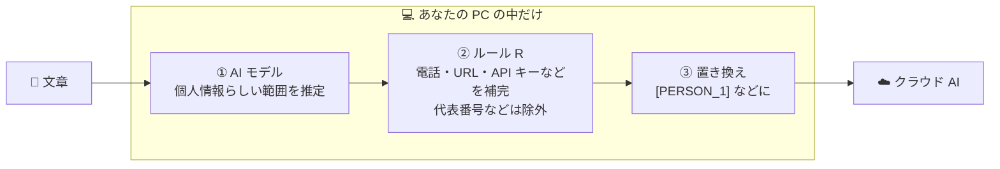
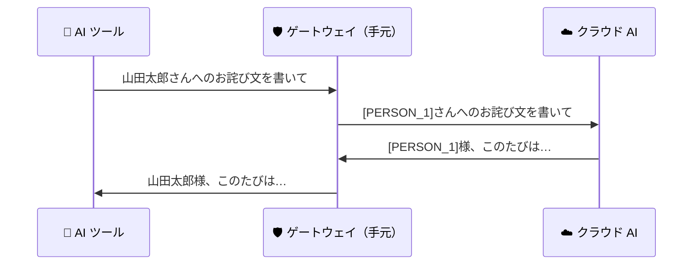
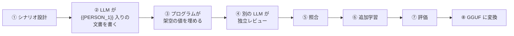

<div align="center">

# 🐯 Toramon Mask

**日本語の文章から個人情報を見つけて伏せる、オープンソースのマスキングツール**

社内の文章を ChatGPT や Claude などのクラウド AI に送る前に、**自分の PC の中だけで** 氏名・住所・電話番号・API キーなどを伏せ字にします。

[](LICENSE)
[](https://www.python.org/)
[](#-動作環境ミニマムスペック)
[](#-動作環境ミニマムスペック)
[](#-セキュリティ)
[](#-toramon-shield-について)

[動作環境](#-動作環境ミニマムスペック) ・ [特長](#-特長) ・ [しくみ](#-しくみ) ・ [クイックスタート](#-クイックスタート) ・ [使い方](#-使い方) ・ [精度を測る](#-精度を測る) ・ [学習する](#-自分でモデルを学習する上級者向け) ・ [FAQ](#-よくある質問)

</div>

```text
入力 : 山田太郎様、お届け先は東京都千代田区丸の内1-2-3、連絡先は090-1234-5678 です。
出力 : [PERSON_1]様、お届け先は[ADDRESS_1]、連絡先は[PHONE_1] です。
```

> [!IMPORTANT]
> - このリポジトリには **AI モデルの重みファイルは含まれていません**。公開モデルは [クイックスタート](#-クイックスタート) の手順で自動ダウンロードします。
> - どのモデルも **見逃しはゼロになりません**。重要な文書は人の目でも確認してください。

---

## 💻 動作環境（ミニマムスペック）

**GPU は要りません。** ふつうの Linux PC や、クラウドの小さな仮想マシンで動きます。

| | 🟢 最低限（試す・使う） | 🔵 推奨（快適に使う） | 🟣 学習もする |
|---|---|---|---|
| **OS** | Linux（64bit） | Ubuntu 22.04 / 24.04 | Ubuntu 24.04 |
| **CPU** | 64bit・2 コア | 4 コア以上 | — |
| **メモリ** | **4 GB**（軽量版モデル q8 を使う場合） | 8 GB 以上 | 64 GB 以上 |
| **GPU** | 不要 | 不要（NVIDIA GPU があれば高速化できる） | NVIDIA GPU（CUDA 対応）必須 |
| **ディスク** | 空き **6 GB** | 空き 10 GB | 空き 50 GB 以上 |
| **ソフト** | `git`、`cmake` 3.20 以上、`g++`、Python 3.11 以上 | 左に加えて [uv](https://docs.astral.sh/uv/) | 左に加えて Docker、NVIDIA Container Toolkit |
| **ネット** | 初回のダウンロード時だけ（約 4.5 GB） | 同左 | 同左（さらに約 5.6 GB） |

<details>
<summary>📏 実測値（どのくらいのメモリと時間を使うか）</summary>

DGX Spark の CPU（Arm 20 コア）で、使うコア数を制限して計測しました。時間はモデルの読み込みを含みます。お使いの PC では前後します。

| モデル | ファイル | 使うメモリ | 約 2,000 字の文書 1 件（4 コア） | 同（20 コア） |
|---|---|---|---|---|
| **q8（軽量版・おすすめ）** | 1.6 GB | 約 1.7 GB | 約 4 秒 | 約 1 秒 |
| f16（標準版） | 2.8 GB | 約 2.9 GB | 約 8 秒 | 約 1.5 秒 |

- 同梱の公開ベンチマーク 5 種類で、**q8 と f16 の点数は完全に同じ** でした。迷ったら q8 を使ってください。
- 一度起動すれば、2 件目からはモデルの読み込みが要りません（ローカル API やゲートウェイとして常駐させる使い方）。
- 学習の動作確認は DGX Spark（GB10、128 GB 統合メモリ）で行いました。これより小さい GPU での学習は確認していません。

</details>

<details>
<summary>🪟 Windows や Mac では使えますか？</summary>

- **Windows**：WSL2 の Ubuntu の中で、Linux と同じ手順で動く見込みです（未確認）。
- **macOS**：今は対応していません。ビルドスクリプトが Linux 用の共有ライブラリ（`.so`）を作るためです。
- **Windows / Mac で使うだけなら**：Linux のサーバーでゲートウェイを動かし、各 PC からはブラウザ拡張やクリップボードツールでつなぐ方法があります（[docs/gateway_README.md](docs/gateway_README.md)）。

</details>

---

## ✨ 特長

| | 特長 | 説明 |
|:---:|---|---|
| 🔒 | **外に出さない** | 判定は手元の PC で動く小さな AI モデル（約 15 億パラメータ）とルールで行います。文章をどこにも送りません |
| 🇯🇵 | **日本語に強い** | 日本語の氏名・住所・電話番号・口座番号・マイナンバーなどを対象にした公開モデルを使います |
| 🏢 | **仕事の情報は残す** | 会社の代表番号、共用メール（`info@` など）、納期、金額、型番は伏せません（[保護方針](docs/annotation_policy.md)） |
| 🔁 | **元に戻せる** | ゲートウェイ経由なら、AI の返事に含まれる `[PERSON_1]` を元の名前に戻して表示します |
| 🛑 | **鍵は送らせない** | API キーやパスワードを含む文章は、クラウドへの送信そのものを止められます |
| 🧩 | **4 通りの使い方** | コマンド、ローカル API、OpenAI 互換ゲートウェイ、ブラウザ拡張 |
| 🎓 | **育てられる** | 自分の業務文書に合わせて追加学習し、点数で比べるための一式（合成データ生成、独立レビュー、評価器）つき |
| 📄 | **自由に使える** | Apache-2.0。商用・社内利用、改変、再配布ができます |

---

## 🔍 しくみ



1. **AI モデル** が、文章のどこからどこまでが個人情報かを推定します（「トークン分類」という方式です。文章を作る AI ではありません）。
2. **共通ルール R**（[`configs/rules_R.yaml`](configs/rules_R.yaml)）が、形の決まった情報の見逃しを補い、範囲のずれを直し、残すべきものを除外します。
3. 見つかった範囲を `[PERSON_1]` のような **伏せ字** に置き換えます。

### 伏せる 8 種類

| 種類 | 例 | 伏せ字 |
|---|---|---|
| 👤 個人名 | 山田太郎、ヤマダ タロウ | `[PERSON_n]` |
| 🏠 個人の住所 | 東京都千代田区丸の内1-2-3 | `[ADDRESS_n]` |
| 📞 個人の電話番号 | 090-1234-5678 | `[PHONE_n]` |
| ✉️ 個人のメール | taro.yamada@example.co.jp | `[EMAIL_n]` |
| 📅 個人に紐づく日付 | 生年月日、入院日 | `[DATE_n]` |
| 🔢 番号類 | 口座番号、会員番号、マイナンバー | `[ACCOUNT_n]` |
| 🔗 個人に紐づく URL | パスワード再設定リンク | `[URL_n]` |
| 🔑 認証情報 | パスワード、API キー、トークン | `[SECRET_n]` |

---

## 🚀 クイックスタート

GPU なしで、**約 15 分** で試せます。以下はすべてターミナルで実行します。

### 1. 必要なものを入れる

Ubuntu の場合は、次の 2 行で揃います。

```bash
sudo apt update && sudo apt install -y git cmake build-essential python3 python3-venv curl
curl -LsSf https://astral.sh/uv/install.sh | sh   # uv（Python の高速なパッケージ管理ツール）
```

入れたあと、ターミナルを開き直してください（`uv` コマンドが使えるようになります）。

### 2. ダウンロードして準備する

```bash
git clone https://github.com/toramon-shield/toramon-mask.git
cd toramon-mask

uv venv --python 3.12 .venv                                       # 専用の Python 環境を作る
uv pip install -p .venv/bin/python -r env/requirements-host.txt   # 必要なライブラリ
uv pip install -p .venv/bin/python -e .                           # Toramon Mask 本体
```

<details>
<summary>💡 uv を使わない場合</summary>

```bash
python3 -m venv .venv
.venv/bin/pip install -r env/requirements-host.txt
.venv/bin/pip install -e .
```

</details>

### 3. 推論エンジンをビルドする

```bash
scripts/setup_third_party.sh          # 推論エンジン（privacy-filter-jp.cpp）を決まった版で取得
PF_CUDA=OFF env/build_pfshared.sh     # CPU 版をビルド（数分）
```

`OK: .../libpf.so` と表示されれば成功です。

<details>
<summary>⚡ NVIDIA GPU で高速化したい場合</summary>

CUDA Toolkit（`nvcc`）が入っていれば、`PF_CUDA=OFF` の代わりに GPU の世代を指定して GPU 版をビルドできます。

```bash
CUDA_ARCH=89 env/build_pfshared.sh    # RTX 30 系 = 86、RTX 40 系 = 89、H100 = 90、DGX Spark = 121
```

以降のコマンドの `--device cpu` を `--device cuda` に変えてください。

</details>

### 4. モデルをダウンロードする（約 4.5 GB）

```bash
scripts/download_models.sh
```

軽量版（q8）と標準版（f16）の両方を `models/` に保存し、ファイルが壊れていないか（SHA256）まで自動で確かめます。最後に `OK` が並べば成功です。

### 5. 動かしてみる 🎉

```bash
echo "山田太郎様、お届け先は東京都千代田区丸の内1-2-3、連絡先は090-1234-5678、メールは taro.yamada@example.co.jp です。担当: 株式会社サンプル商事 営業部" \
  | .venv/bin/python scripts/toramon_cli.py redact --backend S --device cpu \
      --gguf models/sumeshi-privacy-filter-jp-GGUF/privacy-filter-jp-q8.gguf
```

次のように表示されれば完成です。会社名は「仕事の情報」なので伏せられていません。

```text
[PERSON_1]様、お届け先は[ADDRESS_1]、連絡先は[PHONE_1]、メールは [EMAIL_1] です。担当: 株式会社サンプル商事 営業部
```

<details>
<summary>🧪 テストを実行する（任意）</summary>

```bash
TORAMON_TEST_DEVICE=cpu .venv/bin/python -m pytest -q     # CPU 版をビルドした場合
.venv/bin/python -m pytest -q                             # GPU 版をビルドした場合
```

`105 passed` のように表示されれば成功です。libpf やモデルがまだない場合、それらを使うテストは自動でスキップされます。

</details>

---

## 📖 使い方

長いパスは変数にしておくと楽です。

```bash
GGUF=models/sumeshi-privacy-filter-jp-GGUF/privacy-filter-jp-q8.gguf
DEV=cpu        # GPU 版をビルドした場合は cuda
```

| やりたいこと | 方法 |
|---|---|
| ファイルを伏せ字にしたい | [⌨️ コマンド](#コマンドcli) |
| 自分のプログラムから呼びたい | [🔌 ローカル API](#ローカル-api) または [🐍 Python](#python-から使う) |
| ChatGPT などの API に送る前に自動で伏せたい | [🛡️ ゲートウェイ](#ゲートウェイopenai-互換プロキシ) |
| ブラウザやクリップボードで使いたい | [docs/gateway_README.md](docs/gateway_README.md) |

### コマンド（CLI）

```bash
# 伏せ字にした文章を出力
cat 文書.txt | .venv/bin/python scripts/toramon_cli.py redact --backend S --device $DEV --gguf $GGUF

# どこを何として検出したかを JSON で出力（開始・終了位置、種類、確信度）
cat 文書.txt | .venv/bin/python scripts/toramon_cli.py detect --backend S --device $DEV --gguf $GGUF
```

| オプション | 意味 |
|---|---|
| `--style asterisk` | `[PERSON_1]` ではなく `****` で伏せる |
| `--no-rules` | ルール R を使わず、モデルだけで判定する（比較用） |
| `--threshold 0.5` | 確信度のしきい値。上げると伏せる量が減り、下げると増える |
| `--backend T-O` / `T-S` | 自分で学習・変換したモデルを使う（[学習する](#-自分でモデルを学習する上級者向け)） |

### ローカル API

```bash
.venv/bin/python scripts/toramon_cli.py serve --backend S --device $DEV --gguf $GGUF --port 8765
```

別のターミナルから:

```bash
curl -s -X POST http://127.0.0.1:8765/redact -H 'Content-Type: application/json' \
  -d '{"text":"佐藤花子さんの電話は080-1111-2222です。"}'
# → {"status":"ok", "redacted_text":"[PERSON_1]さんの電話は[PHONE_1]です。", "spans":[...], ...}
```

| エンドポイント | 内容 |
|---|---|
| `GET /health` | 動作確認 |
| `POST /detect` | 検出結果（範囲の一覧）を返す |
| `POST /redact` | 伏せ字にした文章と検出結果を返す |

既定では、自分の PC（`127.0.0.1`）からしか接続できません。

### ゲートウェイ（OpenAI 互換プロキシ）

AI ツールとクラウドの間に挟むと、**送る文章は自動で伏せ字に、返ってきた答えは元の値に戻して** くれます。



```bash
.venv/bin/python scripts/toramon_gateway.py --backend S --device $DEV --gguf $GGUF \
  --port 8787 --upstream https://api.openai.com

# AI ツール側は、接続先をゲートウェイに向けるだけ（API キーは今までどおり。ゲートウェイは保存しません）
export OPENAI_BASE_URL=http://127.0.0.1:8787/v1
```

- `http://127.0.0.1:8787/admin` で、伏せた件数などの集計を見られます（原文は記録しません）。
- `--block-labels secret`（既定）: API キーやパスワードを含む要求は、送信そのものを止めます。

<details>
<summary>🧪 本物の API に送らずに試す</summary>

受け取った文章をそのまま返すダミーの送信先を使えます。

```bash
.venv/bin/python scripts/mock_upstream.py --port 8799        # ターミナル 1
.venv/bin/python scripts/toramon_gateway.py --backend S --device $DEV --gguf $GGUF \
  --port 8787 --upstream http://127.0.0.1:8799                # ターミナル 2
```

</details>

ブラウザ拡張、クリップボード常駐ツール、社内配布の方法は [docs/gateway_README.md](docs/gateway_README.md) を見てください。

### Python から使う

```python
from toramon.adapters.sumeshi_pf import SumeshiPF
from toramon.filter import ToramonFilter

det = SumeshiPF("models/sumeshi-privacy-filter-jp-GGUF/privacy-filter-jp-q8.gguf", device="cpu")
f = ToramonFilter(det, "S")
res = f.redact("山田太郎様の電話は090-1234-5678です。")
print(res.redacted_text)        # [PERSON_1]様の電話は[PHONE_1]です。
for s in res.spans:
    print(s["start"], s["end"], s["label"])
```

---

## 📊 精度を測る

正解つきのデータ（JSONL 形式）でモデルを動かし、点数を出せます。sumeshi さんの公開ベンチマークを変換したものを [`data/public_bench/`](data/public_bench/) に同梱しています。

```bash
# 1) モデルで予測する
.venv/bin/python scripts/run_model.py --model S --device $DEV --gguf $GGUF \
  --input data/public_bench/sumeshi_eval2.jsonl --out runs/demo/S_eval2.pred.jsonl

# 2) 正解と比べて採点する
.venv/bin/python scripts/evaluate.py --gold data/public_bench/sumeshi_eval2.jsonl --pred runs/demo/S_eval2.pred.jsonl
```

<details>
<summary>🔬 ルール R の効果を比べる（差の 95% 信頼区間つき）</summary>

```bash
.venv/bin/python scripts/run_filter.py --backend S --device $DEV --gguf $GGUF \
  --input data/public_bench/sumeshi_eval2.jsonl --out runs/demo/S_model_only.pred.jsonl --config model_only
.venv/bin/python scripts/run_filter.py --backend S --device $DEV --gguf $GGUF \
  --input data/public_bench/sumeshi_eval2.jsonl --out runs/demo/S_rules_all.pred.jsonl --config rules_all
.venv/bin/python scripts/evaluate.py --gold data/public_bench/sumeshi_eval2.jsonl \
  --pred runs/demo/S_rules_all.pred.jsonl --compare runs/demo/S_model_only.pred.jsonl
```

</details>

| 指標 | 意味 | 良い方向 |
|---|---|---|
| strict F1 | 範囲と種類が **完全に一致** した割合（適合率と再現率の調和平均） | ⬆️ 高い |
| 全範囲保護率 | 正解の個人情報が **1 文字も漏れずに** 伏せられた割合 | ⬆️ 高い |
| PII 残存文書率 | 個人情報が 1 つでも残った文書の割合 | ⬇️ 低い |
| 非対象文字マスク率 | 伏せなくてよい文字まで伏せた割合（伏せすぎ） | ⬇️ 低い |
| 負例文書誤検知率 | 個人情報のない文書で、誤って何かを伏せた割合 | ⬇️ 低い |

> [!NOTE]
> 公開ベンチは作者の方針で正解が付けられているため、このリポジトリの [保護方針](docs/annotation_policy.md) とは一部で判断が異なります。動作確認・診断用と考えてください。

データ形式（1 行 1 文書）は [`configs/data_schema.json`](configs/data_schema.json) で定義しています。`start` / `end` は **文字単位** の位置です。

```json
{"id": "doc-1", "text": "山田太郎様", "entities": [{"start": 0, "end": 4, "label": "private_person", "action": "MASK"}]}
```

---

## 🎓 自分でモデルを学習する（上級者向け）

自分の業務文書に合わせてモデルを鍛えられます。**NVIDIA GPU と Docker が必要** です（[動作環境](#-動作環境ミニマムスペック) の「学習もする」列）。



> [!TIP]
> LLM には `{{PERSON_1}}` のような **プレースホルダ入りの文書** だけを書かせ、氏名や電話番号は **プログラムが架空の値を埋め込みます**（[`src/toramon/datagen/pools.py`](src/toramon/datagen/pools.py)）。正解の位置が正確になり、実在の個人情報も入り込みません。

<details>
<summary><b>ステップ 1：準備</b></summary>

```bash
scripts/download_models.sh --all          # OpenAI のモデルも取得（さらに約 5.6 GB）
docker build -f env/Dockerfile -t toramon-mask:0.1 .   # 学習用コンテナ（先に setup_third_party.sh が必要）
./env/run.sh python -c "import torch; print(torch.cuda.is_available())"   # True なら OK

# T-S の起点: sumeshi の GGUF を学習できる HF 形式に戻す
.venv/bin/python scripts/convert_gguf_to_hf.py --gguf models/sumeshi-privacy-filter-jp-GGUF/privacy-filter-jp-f16.gguf \
  --ref models/openai-privacy-filter --out models/sumeshi-privacy-filter-jp-hf-from-f16
```

Dockerfile のベースイメージは DGX Spark（Arm64）向けの NVIDIA PyTorch コンテナです。x86_64 の PC では、同じ世代の `nvcr.io/nvidia/pytorch` に差し替えてください。

</details>

<details>
<summary><b>ステップ 2：学習データを作る</b></summary>

文書の生成とレビューには、次のどれかの LLM を使います。

| 経路 | 使うもの | 必要な設定 |
|---|---|---|
| `gpt` | [OpenAI Codex CLI](https://github.com/openai/codex)（`codex`） | `codex login` 済み |
| `gemini` / `claude` | Antigravity CLI（`agy`） | ログイン済み |
| `local` | OpenAI 互換の API サーバー（vLLM、llama.cpp server、Ollama など） | `TORAMON_LLM_URL`、`TORAMON_LLM_MODEL`（必要なら `TORAMON_LLM_API_KEY`） |

```bash
export TORAMON_LLM_URL=http://127.0.0.1:8000/v1/chat/completions
export TORAMON_LLM_MODEL=qwen3-32b    # サーバーで動かしているモデル名に置き換え

ROUTES=local          # 生成担当。codex や agy も使えるなら gpt,gemini,claude,local など
REVIEWERS=local       # レビュー担当。生成担当とは別の経路が望ましい

for SPLIT in train dev; do
  N=$([ $SPLIT = train ] && echo 3000 || echo 500)
  SEED=$([ $SPLIT = train ] && echo 1 || echo 2)
  .venv/bin/python scripts/make_jobs.py --split $SPLIT --n $N --out data/$SPLIT/jobs.jsonl --seed $SEED --routes $ROUTES  # ① 何を書かせるか
  .venv/bin/python -m toramon.llm.generate --jobs data/$SPLIT/jobs.jsonl --out data/$SPLIT/raw --routes $ROUTES           # ② 生成
  .venv/bin/python scripts/fill_docs.py --raw data/$SPLIT/raw --split $SPLIT --pool $SPLIT --out data/$SPLIT/filled.jsonl # ③ 値を埋める
  .venv/bin/python -m toramon.llm.review --docs data/$SPLIT/filled.jsonl --out data/$SPLIT/reviews --reviewers $REVIEWERS # ④ レビュー
  .venv/bin/python -m toramon.datagen.reconcile --docs data/$SPLIT/filled.jsonl --reviews data/$SPLIT/reviews \
    --out-docs data/$SPLIT/$SPLIT.jsonl --out-report data/$SPLIT/reconcile_report.json                                    # ⑤ 照合
done

.venv/bin/python scripts/audit_splits.py data/train/train.jsonl data/dev/dev.jsonl --out runs/audit/splits.json  # 分割間の重複を検査
```

結果は `data/train/train.jsonl`（学習用）と `data/dev/dev.jsonl`（選抜用）です。

- **独立レビュー**: 書いた本人（同じ LLM）がレビューすると見落としが重なりやすいので、レビュー担当は別の経路が理想です（例: `ROUTES=local REVIEWERS=gpt`）。同じ経路でも動きますが、警告が出ます。`--reviewers` を省くと「生成担当以外の全経路」が使われます。
- 学習用・選抜用・最終評価用は [`configs/scenario_families.yaml`](configs/scenario_families.yaml) で **シナリオ単位** に分けています。似た文書が別の分割に混ざって点数が水増しされるのを防ぐためです。
- 公開データからも作れます: Dolly 日本語版（`scripts/make_dolly_jobs.py` → `src/toramon/llm/generate_batch.py` → `scripts/make_dolly_dataset.py`）、NVIDIA Nemotron-PII-Japan（`scripts/convert_nemotron.py`）。**再配布するときは元のライセンス（CC BY-SA 3.0 / CC BY 4.0）に従ってください。**

</details>

<details>
<summary><b>ステップ 3：学習する</b></summary>

```bash
# T-O: OpenAI モデルを起点に（MoE の experts を凍結して軽く学習）
./env/run.sh python -m toramon.train.finetune_hf --base /models/openai-privacy-filter \
  --train data/train/train.jsonl --dev data/dev/dev.jsonl --out runs/my_to --mode experts_frozen --epochs 3 --lr 1e-4

# T-S: sumeshi モデルを起点に（LoRA で学習）
./env/run.sh python -m toramon.train.finetune_hf --base /models/sumeshi-privacy-filter-jp-hf-from-f16 \
  --train data/train/train.jsonl --dev data/dev/dev.jsonl --out runs/my_ts --mode lora --epochs 3 --lr 1e-4
```

コンテナの中では、リポジトリが `/work`、`models/` が `/models` に見えます。結果は `runs/<名前>/model/`（HF 形式）、`train_summary.json`、`dev_eval.json` に保存されます。

</details>

<details>
<summary><b>ステップ 4：比べる・最終評価・GGUF に変換</b></summary>

```bash
# 複数モデル × ルールあり/なしを一括比較し、report.md / report.csv を作る
.venv/bin/python scripts/run_comparison.py --gold data/dev/dev.jsonl --out runs/dev_compare --title "dev 比較" --baseline S \
  --model S=gguf:$GGUF --model T-O=hf:identity:/work/runs/my_to/model --configs model_only,rules_all

# 最終評価（任意。選んだモデルを test 分割で「一度だけ」評価する）
#  1) ステップ 2 のループを SPLIT=test（例: N=1000, SEED=3）で実行し、結果を置く
mkdir -p eval/locked && cp data/test/test.jsonl eval/locked/filled.jsonl
#  2) 正解を凍結する（人手確認の修正ファイルがあれば --decisions で指定）
.venv/bin/python scripts/freeze_locked_test.py --allow-unverified
#  3) 評価条件を凍結する（候補・基準モデルと評価コードのハッシュを記録）
.venv/bin/python scripts/freeze_conditions.py --candidate T-O=runs/my_to/model --baseline S=$GGUF --reason "dev 比較で選定"
#  4) 一括評価 → runs/final/report.md（CPU 版 libpf の場合は TORAMON_DEVICE=cpu を付ける）
bash scripts/final_eval.sh

# HF 形式 → GGUF に変換（CLI・ゲートウェイで使える形）
bash scripts/convert_hf_to_gguf.sh runs/my_to/model my-to f16
.venv/bin/python scripts/verify_gguf_hf_parity.py --help   # 変換前後で数値が一致するかの検証
```

変換した GGUF は `--backend T-O --gguf runs/gguf/my-to/my-to-f16.gguf` で使えます。評価設計の考え方は [docs/data_design.md](docs/data_design.md) と [configs/acceptance.yaml](configs/acceptance.yaml) にあります。

</details>

---

## 📚 ドキュメント

| ドキュメント | 内容 |
|---|---|
| 🛡️ [docs/gateway_README.md](docs/gateway_README.md) | ゲートウェイ、ブラウザ拡張、クリップボードツール、社内配布 |
| 📏 [docs/annotation_policy.md](docs/annotation_policy.md) | 何を伏せて何を残すかの保護方針 |
| 🧪 [docs/data_design.md](docs/data_design.md) | 学習・評価データの設計（分割、最終テストの隔離） |
| ⚙️ [configs/rules_R.yaml](configs/rules_R.yaml) | 共通ルール R |
| 📐 [configs/data_schema.json](configs/data_schema.json) | データ形式 |

---

## 🗂️ フォルダ構成

```text
toramon-mask/
├── src/toramon/        本体のライブラリ
│   ├── filter.py         検出 → ルール → 置き換えをまとめたフィルタ
│   ├── api.py            ローカル API（FastAPI）
│   ├── evaluate.py       評価器（各指標、ブートストラップ信頼区間）
│   ├── adapters/         モデルごとの呼び出し口（GGUF / OpenAI 公式 / HF 形式）
│   ├── rules/            共通ルール R のエンジン
│   ├── datagen/          合成値の生成・埋め込み・レビュー照合
│   ├── llm/              データ生成・レビュー用 LLM の呼び出し
│   └── train/            追加学習
├── scripts/            CLI、ゲートウェイ、評価、データ作成、変換などのスクリプト
├── configs/            ラベル対応表、ルール R、データ形式、シナリオ分割、受入基準、モデルの SHA256
├── prompts/            データ生成・レビュー用のプロンプト
├── gateway/            ブラウザ拡張、クリップボード常駐ツール、配布用メモ
├── env/                Dockerfile、ビルドスクリプト、外部リポジトリへのパッチ
├── data/public_bench/  動作確認用の公開ベンチマーク（MIT）
├── docs/               保護方針、データ設計、ゲートウェイの説明
└── tests/              テスト
```

<details>
<summary>スクリプトが作るフォルダ（GitHub には上がりません）</summary>

| フォルダ | 中身 |
|---|---|
| `.venv/` | Python の環境 |
| `third_party/` | 推論エンジンなどの外部リポジトリ（`setup_third_party.sh`） |
| `models/` | ダウンロードしたモデル（`download_models.sh`） |
| `data/train/` など、`runs/`、`checkpoints/`、`eval/` | 生成データ、学習結果、ログ、最終評価用データ |

</details>

<details>
<summary>⚙️ 環境変数の一覧</summary>

| 変数 | 既定値 | 用途 |
|---|---|---|
| `TORAMON_MODELS_DIR` | `./models` | モデルの置き場所 |
| `TORAMON_PFJP_DIR` | `./third_party/privacy-filter-jp.cpp` | 推論エンジンの場所 |
| `PF_CUDA` | `ON` | `OFF` で CPU 版をビルド |
| `CUDA_ARCH` | `121` | GPU 版ビルド時の GPU 世代 |
| `TORAMON_TEST_DEVICE` | `cuda` | テストで使うデバイス（`cpu` / `cuda`） |
| `TORAMON_DEVICE` | `cuda` | `run_comparison.py`／`final_eval.sh` のデバイス |
| `TORAMON_LLM_URL` | `http://127.0.0.1:8000/v1/chat/completions` | データ生成の `local` 経路の接続先 |
| `TORAMON_LLM_MODEL` | `local-model` | `local` 経路のモデル名 |
| `TORAMON_LLM_API_KEY`／`TORAMON_LLM_API_KEY_FILE` | なし | `local` 経路の API キー（またはキーを書いたファイル） |
| `TORAMON_MODEL_GPT`／`TORAMON_MODEL_GEMINI`／`TORAMON_MODEL_CLAUDE` | ソース参照 | CLI 経路で使うモデル ID |
| `TORAMON_IMAGE` | `toramon-mask:0.1` | `env/run.sh` が使う Docker イメージ |

</details>

---

## 🔐 セキュリティ

| ✅ 守れるもの | ❌ 守れないもの |
|---|---|
| クラウド AI に送る文章から、個人情報と認証情報を伏せる | モデルの見逃し（見逃しはゼロになりません） |
| 処理を手元の PC で完結させ、原文を外に出さない | 伏せ字にしても、文脈から人物が推測できる場合 |
| API キーやパスワードを含む要求の送信を止める（ゲートウェイ） | ゲートウェイを通さずに送った文章 |

- ゲートウェイの監査ログ（既定 `~/.toramon/gateway_audit.jsonl`）には件数と種類だけを記録し、原文は保存しません。
- API キーなどは **環境変数で渡し**、リポジトリにコミットしないでください（`.env` や `*.key` は `.gitignore` 済みです）。
- テストやルールに含まれる `sk-test-...` や `AKIA...EXAMPLE` は、すべて **架空のダミー** です。

**脆弱性を見つけたら**：公開の Issue には書かず、GitHub の **Security → Report a vulnerability**（非公開の報告）から知らせてください。

---

## ❓ よくある質問

<details>
<summary><b><code>libpf.so</code> が見つからないと言われます。</b></summary>

[クイックスタートのステップ 3](#3-推論エンジンをビルドする) が終わっていません。`scripts/setup_third_party.sh` → `PF_CUDA=OFF env/build_pfshared.sh` を実行してください。

</details>

<details>
<summary><b><code>pf_load failed: no usable 'cuda' device</code> と出ます。</b></summary>

CPU 版をビルドしたのに `--device cuda` で動かしています。`--device cpu` にするか、GPU 版をビルドし直してください。

</details>

<details>
<summary><b>ビルドが <code>cmake</code> のエラーで止まります。</b></summary>

`runs/logs/pfshared_build.log` の末尾を見てください。`cmake` が古い、または `g++` が入っていないことが多いです。GPU 版で `unsupported gpu architecture` と出る場合は、`CUDA_ARCH` があなたの GPU と合っていません。

</details>

<details>
<summary><b><code>hf: command not found</code> や SHA256 の <code>FAILED</code> が出ます。</b></summary>

- `hf: command not found`：[ステップ 2](#2-ダウンロードして準備する) が終わっていません（`.venv/bin/hf` を使います）。
- `FAILED`：ダウンロードが途中で切れています。該当ファイルを消してもう一度実行してください。

</details>

<details>
<summary><b>伏せてほしいものが残る／伏せすぎます。</b></summary>

`--threshold` を調整するか、ルール R（[`configs/rules_R.yaml`](configs/rules_R.yaml)）に規則を足してください。判断基準は [保護方針](docs/annotation_policy.md) にあります。自分の文書でよく外れるなら、[追加学習](#-自分でモデルを学習する上級者向け) も検討してください。

</details>

<details>
<summary><b>メモリが少ない PC でも動きますか？</b></summary>

軽量版の q8 モデルなら、使うメモリは約 1.7 GB です。メモリ 4 GB の PC でも動きます。公開ベンチでは標準版の f16 と点数は同じでした。

</details>

<details>
<summary><b>長い文書は扱えますか？</b></summary>

はい。内部で区切って処理するので、そのまま渡せます。CPU 版では文書が長いほど時間がかかります（約 2,000 字で 1〜8 秒が目安です）。

</details>

<details>
<summary><b>インターネットにつながっていない PC で使えますか？</b></summary>

はい。最初の準備（ステップ 1〜4）が終われば、伏せる処理にネット接続は要りません。ゲートウェイを使う場合だけ、送信先のクラウド AI への接続が必要です。

</details>

---

## 📝 用語集

| 用語 | 意味 |
|---|---|
| **PII** | Personally Identifiable Information。個人を特定できる情報 |
| **マスキング／伏せ字** | 個人情報を `[PERSON_1]` などの記号に置き換えること |
| **S** | 基準にする公開モデル [sumeshi/privacy-filter-jp-GGUF](https://huggingface.co/sumeshi/privacy-filter-jp-GGUF)（日本語向け）。クイックスタートで使います |
| **O** | OpenAI が公開したモデル [openai/privacy-filter](https://huggingface.co/openai/privacy-filter)（英語中心） |
| **T-O / T-S** | このリポジトリの手順で O / S を追加学習したモデル。重みは同梱していません |
| **GGUF** | AI モデルを 1 ファイルにまとめた形式。軽量な C++ エンジン（privacy-filter-jp.cpp）で動きます |
| **q8 / f16** | モデルの数値の精度。q8 は軽量版、f16 は標準版 |
| **libpf** | 推論エンジンをライブラリにしたもの。Python から GGUF モデルを呼ぶのに使います |
| **span（スパン）** | 文章の中の「何文字目から何文字目まで」という範囲 |
| **MASK / KEEP / REVIEW** | 正解データの区分。伏せる／残す／判断が割れる（学習・採点から除外） |

---

## 🐯 Toramon Shield について

**Toramon Shield** は、**「日本の個人情報を守る」** という理念のもと、**AIGYM株式会社** が立ち上げたオープンソースプロジェクトです。

個人情報を守るしくみは、一部の専門家だけのものではなく、誰もが理解し、確かめ、使えるものであるべきだと私たちは考えています。そのため、Toramon Shield のツールはすべてソースコードを公開し、日本語で読めるドキュメントを用意しています。

| プロジェクト | 内容 | 状態 |
|---|---|---|
| [**2password**](https://github.com/toramon-shield/2password) | 1Password の安全設計を再現した、学習用のパスワード保管庫 | 公開中 |
| **toramon-mask**（このリポジトリ） | 日本語の個人情報をマスキングするツール | ベータ |

---

## 🗺️ ロードマップ

- [x] CLI・ローカル API・OpenAI 互換ゲートウェイ
- [x] 共通ルール R（電話・URL・API キーの補完、代表番号などの除外）
- [x] 合成データ生成・独立レビュー・評価器・追加学習の一式
- [x] CPU だけで動く構成（GPU 不要）
- [ ] 学習済みモデル（T-O / T-S）の公開
- [ ] macOS / Windows でのネイティブ動作
- [ ] ブラウザ拡張のストア公開
- [ ] 第三者による精度・セキュリティの検証

---

## 🤝 コントリビュート

バグ報告、改善の提案、ドキュメントの修正を歓迎します。

- 🐛 **バグ・要望**：[Issues](https://github.com/toramon-shield/toramon-mask/issues) に書いてください。**実在の個人情報を含む文章は貼らないでください。**
- 🔧 **修正の提案**：Pull Request を送ってください。送る前に `TORAMON_TEST_DEVICE=cpu .venv/bin/python -m pytest -q` が通ることを確認してください。
- 🔐 **脆弱性**：公開の Issue ではなく、**Security → Report a vulnerability** から知らせてください。

---

## 🙏 謝辞

- 日本語 PII の検出モデルと推論エンジン、ベンチマークを公開してくださった **sumeshi さん**
  - [sumeshi/privacy-filter-jp-GGUF](https://huggingface.co/sumeshi/privacy-filter-jp-GGUF)（Apache-2.0）
  - [sumeshi/privacy-filter-jp.cpp](https://github.com/sumeshi/privacy-filter-jp.cpp)（MIT）。`env/patches/` の小さな修正も MIT です
- ベースモデルを公開した **OpenAI** と **OpenMed** の皆さん
  - [openai/privacy-filter](https://huggingface.co/openai/privacy-filter)（Apache-2.0）

`data/public_bench/` は privacy-filter-jp.cpp のベンチマーク（MIT）を形式変換したものです。

---

## 📄 ライセンス

[Apache License 2.0](LICENSE) で公開しています。モデルの重みと外部ソースは同梱しておらず、ダウンロードされるものはそれぞれのライセンスに従います（一覧は [NOTICE](NOTICE)）。

Copyright 2026 AIGYM株式会社（AIGYM Inc.）

<div align="center">

---

**Toramon Shield** — 日本の個人情報を守る

Made with 🐯 by [AIGYM株式会社](https://toramon.ai)

</div>
